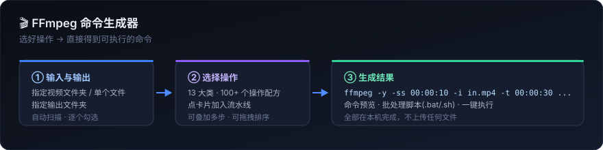

# 🎬 FFmpeg 命令生成器

一个**纯本地运行**的网页工具：指定输入视频（文件夹或单个/多个文件）和输出文件夹，在网页上勾选要做的处理，
立刻得到**可以直接执行的 ffmpeg 命令**和**双击就能跑的批处理脚本**。不需要记任何 ffmpeg 参数。



---

## 快速开始

### 1. 准备环境

| 需要 | 说明 |
|---|---|
| **Node.js 16+** | 只用来跑一个本地小服务（零第三方依赖）。下载：<https://nodejs.org/> |
| **FFmpeg** | 想「在网页里直接执行」才需要。只想生成命令的话可以不装。 |

FFmpeg 的三种放置方式，任选一种：

1. 把 `ffmpeg.exe` 所在目录加入系统 `PATH`；
2. 把 `ffmpeg.exe`、`ffprobe.exe` 复制到本项目的 `bin\` 文件夹；
3. 设置环境变量 `FFMPEG_PATH` 指向 ffmpeg.exe 的完整路径。

> Windows 上如果只想快速试一下：下载 ffmpeg 压缩包，解压后把 `bin` 目录里的两个 exe 丢进本项目的 `bin\` 文件夹即可。

### 2. 启动

* **Windows**：双击 `启动服务.bat`
* **macOS / Linux**：`./启动服务.sh`
* 或者命令行：`node server.js`

然后浏览器打开 <http://127.0.0.1:8787>

> `启动服务.bat` 里的提示文字是英文的，这是刻意为之：cmd.exe 按当前控制台代码页解码批处理文件，
> 中文 Windows 默认是 GBK，混入中文容易出现「'xxx' 不是内部或外部命令」之类的解析错误。
> 中文说明都在本文件里。**生成的 ffmpeg 脚本**不受这个限制，它用了切换代码页后重新进入自身的写法，
> 中文路径和中文进度提示都能正常工作。

端口被占用时换一个：

```bat
:: Windows
set PORT=8899 && node server.js
```
```bash
# macOS / Linux
PORT=8899 node server.js
```

---

## 怎么用（三步）

### ① 输入与输出

* **输入方式** 选「整个文件夹」→ 填（或点 📂 选）视频所在的文件夹，工具会自动扫描出里面的视频，
  每个文件前都有勾选框，不想处理的取消勾选即可。
* 也可以选「单个文件」或「多个文件」。
* **输出文件夹**：处理结果存到哪里。点「检查路径」可以顺便帮你把不存在的输出目录建好。
* **文件名后缀**：默认 `_out`，即 `原片.mp4` → `原片_out.mp4`。

#### 画质档位 —— 别让工具偷偷降低你的画质

每个操作卡片右上角都标着 **「流复制」** 或 **「需重编码」**：

* **流复制**：命令里没有滤镜、直接 `-c copy`，画质**零损失**，速度跟复制文件一样快。
  快速切割、无损转封装、轨道增删、元数据、faststart 都属于这一类。
* **需重编码**：要逐帧改画面（缩放、水印、多区间拼接…），数学上绕不开解码再编码。
  这时候画质由「**画质档位**」统一决定，覆盖各操作里写死的 CRF / preset：

| 档位 | 实际参数 | 适合 |
|---|---|---|
| **跟随源素材**（默认） | 源是 HEVC 就用 libx265、源是 10bit 就保持 10bit，CRF 18 | 想让成品和原片观感一致 |
| 近无损 | CRF 16 + slow | 素材要二次剪辑，文件大也无所谓 |
| 高画质 | CRF 18 + medium | 日常交付 |
| 标准 | CRF 23 + medium | 发社交媒体 |
| 小体积 | CRF 28 + fast | 存档、预览 |
| 不覆盖 | 用各操作自己的参数 | 想逐项微调 |

> 例：无人机拍的 HEVC 4K 素材，默认档位会用 libx265 + CRF 18 编码，而不是粗暴地转成 H.264 8bit CRF 23。

#### 想要「除了我的操作，其它全都不动」？

用 **「保留多个区间并合成一条」→ 默认处理方式「优先速度/无损」**：
它会先把每个区间用 `-c copy` 各切一段，再用 concat 拼起来，**全程不重编码**，
成品编码/画质/CRF 与源素材完全一致，速度也快一个数量级。

> 代价：流复制只能从关键帧开始切，所以每段实际起点会吸附到「设定时间之前的那个关键帧」
> （最多偏早一个 GOP），总时长仍然等于你设定的区间长度之和。
> 需要帧级精确才选「帧级精确」模式（重编码）。默认优先流复制，切点和时长可能受关键帧影响，请检查输出。


### ② 选择要做的处理

左侧是分类，顶上是搜索框（按 <kbd>/</kbd> 快速聚焦）。点任意一张卡片就把它加进流水线。

### ③ 处理流水线 & 生成结果

右侧面板实时显示：

| 标签页 | 内容 |
|---|---|
| **命令预览** | 每条 ffmpeg 命令的完整文本，可单条复制、单条执行、一键全部执行 |
| **批处理脚本** | 整套操作打包成 `.bat` / `.sh` / `.txt`，可保存到输出文件夹或直接下载 |
| **附属文件** | 拼接列表、章节文件等需要先写好的文件，一键生成 |
| **执行日志** | 直接在本机跑 ffmpeg 时的实时输出 |

---

## 流水线是怎么工作的

多个操作会**按顺序**执行，上一步的输出自动成为下一步的输入：

```
输入 a.mp4
  └─ 步骤1 精确剪辑     → a_step1.mp4
       └─ 步骤2 缩放到 1080p → a_step2.mp4
            └─ 步骤3 加文字水印 → a_step3.mp4   ← 成品
```

* 只有一步时，中间名就用你设置的**后缀**（`a_out.mp4`）。
* 流水线里的操作可以拖拽排序、复制、删除。
* 有一类操作（无损拼接、重编码拼接、带转场拼接）需要**吃下全部输入**，卡片右上角标着「多文件」，
  请把它们放在流水线**第一位**。

### 一个例子：批量把文件夹里的视频压到 1080p 并加上水印

1. 输入方式「整个文件夹」→ 选 `D:\素材`；输出 `D:\成品`
2. 加「按宽度等比缩放」，宽度填 `1920`
3. 加「图片水印」，选好水印图、位置选右下、透明度 60%
4. 右侧「批处理脚本」→「保存到输出文件夹」
5. 双击生成的 `生成命令_xxx.bat`，泡杯茶

---

## 操作覆盖范围

**13 个大类、145 个操作、1245 个可调参数**，覆盖日常到进阶的绝大多数 ffmpeg 用法：

| 分类 | 数量 | 能做什么 |
|---|---|---|
| ✂️ **剪辑与切割** | 8 | 精确剪辑、快速无损切割、截取头/尾、平均分段、保留多个区间、删除中间段、HLS 切片 |
| 🔗 **合并拼接** | 3 | 无损拼接、重编码拼接、带转场特效拼接（xfade） |
| 🔄 **格式与编码转换** | 14 | MP4/MKV/WebM/MOV/AVI、ProRes、无损转封装、提取音频、转纯音频、DVD/手机兼容格式、多路输出、音频+封面成片 |
| 📐 **画面尺寸与变换** | 14 | 缩放、限制最大尺寸、裁剪、裁剪比例、补黑边、去黑边、旋转翻转、SAR/DAR、平台尺寸适配、插值放大、像素格式 |
| ⏱️ **速度与帧率** | 5 | 变速、慢动作补帧、延时摄影、定格画面、改帧率 |
| 🔊 **音频处理** | 24 | 音量、淡入淡出、静音段、替换/混合/添加音轨、配背景音乐、声道、重采样、延迟、降噪、响度标准化、高低通、均衡器、变速变调、提取、互转、拼接、裁剪、音量检测 |
| 💧 **水印与叠加** | 10 | 图片水印、文字水印、时间码、画中画、左右/上下并排、四宫格、加边框、色块遮罩、动态漂移水印 |
| 🎨 **画质滤镜** | 16 | 亮度对比度饱和度、色相、色温、锐化、模糊、马赛克/去台标、降噪、去隔行、风格化调色、电影感调色、自动对比度、防抖、色彩空间、HDR 转 SDR、噪点、边缘检测 |
| 💬 **字幕处理** | 11 | 烧录 SRT/ASS 硬字幕、烧录内嵌字幕轨、封装软字幕、提取字幕轨、格式互转、延迟平移、双语字幕、移除字幕轨、附加字体 |
| 🖼️ **图片与序列帧** | 6 | 截图封面、缩略图雪碧图、拆帧、图片序列合成视频、GIF、WebP 动图 |
| 🎚️ **编码质量与性能** | 10 | CRF、目标码率、两遍编码（自动先跑分析遍）、VBV 限码率、GOP、硬件加速（NVENC/QSV/AMF/VideoToolbox/VAAPI）、多线程、限制文件大小、极致压缩、H.265 |
| 🧩 **流与元数据** | 15 | 轨道增删与排序、指定音轨/字幕轨、默认轨与多语言标记、清空/设置元数据、章节、faststart、时间戳修复、提取轨道 |
| 🛠️ **高级与自定义** | 9 | 完全自定义参数、自定义滤镜链、仅输出媒体信息、日志级别、覆盖开关、性能测试、MPEG-TS、生成测试源、空跑分析 |

> 找不到想要的操作？用「高级与自定义 → 自定义参数」直接写 ffmpeg 参数，
> 或者在任何操作的展开表单里填「附加参数」。

---

## 生成的命令能拿到别处用吗

能。命令就是标准的 ffmpeg 命令行：

* **命令预览**里的文本可以直接粘到 CMD / PowerShell / 终端里执行；
* **批处理脚本**生成的 `.bat` / `.sh` 可以在任何装了 ffmpeg 的机器上跑，不依赖本工具。

---

## 项目结构

```
ffmpeg命令生成/
├─ server.js              零依赖本地服务：静态托管 + 文件浏览 + ffprobe + 执行
├─ package.json
├─ 启动服务.bat / .sh      一键启动
├─ public/
│  ├─ index.html          页面结构
│  ├─ css/styles.css      样式
│  └─ js/
│     ├─ engine.js        ★ 命令生成引擎：路径、引号、参数拼装、批处理脚本
│     ├─ recipes-edit.js  配方：剪辑 / 拼接 / 速度帧率 / 图片
│     ├─ recipes-format.js配方：格式转换 / 编码质量 / 流与元数据 / 高级
│     ├─ recipes-visual.js配方：画面变换 / 水印叠加 / 画质滤镜 / 字幕
│     ├─ recipes-audio.js 配方：音频处理
│     └─ app.js           前端交互
├─ bin/                   可选：放 ffmpeg.exe / ffprobe.exe
└─ tools/                 开发自检脚本（普通用户用不到）
   ├─ selftest.js         校验全部配方 + 遍历所有下拉框取值
   ├─ make-fixtures.ps1   生成端到端验证用的测试素材
   ├─ e2e.js              用真实素材生成一批命令
   ├─ run-e2e.ps1         用真实 ffmpeg 逐条执行并统计通过率
   ├─ gen-duration-cases.js / test-durations.ps1  真机执行并断言输出时长
   ├─ test-encoding.js    中文编码回归（纯逻辑，任何环境都能跑）
   ├─ test-cn-e2e.ps1     中文路径的 HTTP 端到端验证（需要服务在跑）
   ├─ test-launcher.ps1   在 936 代码页下验证 .bat 解析 + 选择器编码
   └─ one.ps1             单独跑某一条命令并查看完整报错
```

### 想自己加一个操作？

在任意 `recipes-*.js` 里加一段 `defOp({...})` 就行，不用改引擎：

```js
defOp({
  id: 'my-op',                    // 全局唯一
  cat: 'trim',                    // 属于哪个分类
  name: '我的操作',               // 卡片标题
  desc: '一句话说明它做什么、代价是什么',
  tags: ['关键词'],
  outExt: 'mp4',                  // 输出扩展名，也可以是 (v, ctx) => 'mp4'
  fields: [
    { k: 'speed', label: '倍数', type: 'number', def: 2, col: 6 },
    { k: 'mode', label: '模式', type: 'select', def: 'a', col: 6,
      options: [{ v: 'a', label: '模式 A' }, { v: 'b', label: '模式 B' }] }
  ],
  build(v, ctx) {
    // v = 用户填的字段值；ctx.input / ctx.output / ctx.outputDir / ctx.platform ...
    return {
      preArgs: ['-ss', '00:00:02'],   // 放在 -i 之前
      args: ['-vf', `setpts=${1 / v.speed}*PTS`],
      notes: ['给用户看的说明'],
      warnings: ['给用户看的警告']
    };
  }
});
```

字段类型支持：`text` `number` `time` `select` `bool` `textarea` `path` `dir`。
`build()` 返回的 `inputs` 可以覆盖默认输入（做多输入操作时用），返回 `output: ''` 表示不写输出文件。

改完刷新页面即可生效（浏览器可能缓存 JS，按 <kbd>Ctrl</kbd>+<kbd>F5</kbd> 强制刷新）。

---

## 自检与验证

```bash
# 1) 校验全部配方能否正确生成命令 + 遍历每个下拉框的每一种取值
#    （不需要 ffmpeg，纯逻辑检查）
node tools/selftest.js

# 2) 中文编码回归（不需要 ffmpeg）
node tools/test-encoding.js

# 3) 用真实素材 + 真实 ffmpeg 做端到端验证（需要 ffmpeg）
powershell -ExecutionPolicy Bypass -File tools/make-fixtures.ps1   # 先造测试素材
node tools/e2e.js                                                  # 生成命令清单
powershell -ExecutionPolicy Bypass -File tools/run-e2e.ps1         # 逐条真机执行

# 3b) 时长断言：专门抓「命令能跑但输出时长错了」这种静默 bug
node tools/gen-duration-cases.js
powershell -ExecutionPolicy Bypass -File tools/test-durations.ps1

# 4) Windows 编码兼容性（在默认代码页 936 下验证 .bat 解析与选择器编码）
powershell -ExecutionPolicy Bypass -File tools/test-launcher.ps1

# 5) 中文路径 HTTP 端到端（先把服务跑起来）
powershell -ExecutionPolicy Bypass -File tools/test-cn-e2e.ps1
```

`test/` 目录是自检产生的临时素材，**可以随时整个删掉**，需要时用 `tools/make-fixtures.ps1` 重新生成。

### 本项目的验收结果

| 检查项 | 结果 |
|---|---|
| 配方结构（id 唯一、分类存在、字段不冲突、无脏值） | **145 / 145 通过** |
| 取值组合遍历（每个 select 的每个选项 × bool 组合，校验 `showIf` / `outExt` / `build` 不抛错、命令无 `undefined`/`NaN`） | **18,184 种组合，0 异常** |
| 真机执行（146 条命令交给真实 ffmpeg 跑，含多步流水线、两遍编码的准备遍） | **146 / 146 exit 0** |
| 输出时长断言（多区间保留 / 删除中间段 / 变速 / 精确剪辑，有音轨与无音轨各一遍） | **9 / 9 通过** |
| 无损模式（成品编码与源一致、命令里无编码参数） | ✅ 通过 |
| 批处理脚本（生成的 `.bat` 在 cmd 里跑完整流程） | ✅ 产物齐全、失败计数、中文显示正常 |
| 中文编码（GBK/UTF-8 双路解码、JSON 往返、命令与脚本内容、写盘读回） | **19 / 19 通过** |
| 中文路径 HTTP 端到端（列目录 / 扫描 / 建目录 / 存脚本 / 前端资源） | **16 / 16 通过** |
| Windows 936 代码页兼容（.bat 解析 + 原生选择器输出编码） | ✅ 全部通过 |

验证用的 ffmpeg：`2024-02-15 full build`（含 libx264 / libx265 / libzimg，Windows x64）。

---

## 常见问题

**Q：提示「未检测到 FFmpeg」怎么办？**
命令生成和复制完全不受影响，只是网页里的「执行」按钮用不了。按上面「准备环境」的三种方式之一装好 ffmpeg 即可。

**Q：无损切割出来的时间跟设定值差了一点？**
不重新编码时 ffmpeg 只能从关键帧开始切。需要帧级精确就用「精确剪辑（重编码）」，或在「快速无损切割」里勾选「强制精确切割」。

**Q：拼接报错？**
「无损拼接」要求所有片段编码、分辨率、帧率完全一致。不一致就用「重编码拼接」，它会自动统一尺寸后合并。

**Q：命令执行报 `Invalid argument` / `Error reinitializing filters`？**
多半是滤镜链里前后两路的尺寸、帧率或时间基不一致。用「画质滤镜」或「画面尺寸与变换」先统一一次再继续。

**Q：双击 `启动服务.bat` 报「'xxx' 不是内部或外部命令」？**
这种报错来自批处理文件的编码问题，本项目已修复（启动脚本改为纯 ASCII + 生成的脚本用「切换代码页后重新进入自身」的写法）。如果你改过这两个文件，请用 `powershell -ExecutionPolicy Bypass -File tools\test-launcher.ps1` 回归验证一下。

**Q：选了带中文的路径，网页里显示成 `G:\���˻�����\...` 这种乱码？**
这是原生选择器（`/api/pick`）的输出编码问题，已修复：PowerShell 在中文 Windows 下默认按 GBK 输出，而 Node 按 UTF-8 解码。现在服务端会强制选择器用 UTF-8 输出，并且对所有子进程输出做了「优先 UTF-8、失败退回系统 ANSI 代码页」的双路解码。回归验证：`node tools/test-encoding.js` 和 `powershell -ExecutionPolicy Bypass -File tools/test-cn-e2e.ps1`。

**Q：命令报 `Stream specifier ':a' ... matches no streams`？**
素材本身没有音轨，而这个操作需要在滤镜里用 `[0:a]`。现在工具会**自动探测输入有没有音轨**（输入区显示「检测到音轨 / 检测到无音轨」），剪辑、变速这类操作在无音轨时会自动切成只处理画面。如果自动探测不准，可以手动改成「强制按无音轨处理」。

**Q：重新编码后画质变差 / 文件变小了？**
检查「画质档位」（输入区下方）。默认是「跟随源素材」；如果被改成了「标准 CRF 23」或「小体积」，
成品自然会有损。想完全不动画面，就选卡片上标「流复制」的操作，或用「保留多个区间」的**无损模式**。

**Q：命令跑完不报错，但输出时长不对？**
这属于滤镜里的时间写法问题（`trim=start=00:00:10` 里的冒号会被当成滤镜选项分隔符，被静默截断成 `start=0`）。本项目已统一改为秒数写法 `trim=start=10`，并在自检里加了静态检查、在 e2e 里加了时长断言。改过配方的话，跑 `node tools/selftest.js` 和 `tools/test-durations.ps1` 能立刻发现回归。

**Q：能在手机上用吗？**
不能，这是个桌面单机工具，需要访问你本机的文件系统。

**Q：安全吗？会上传我的视频吗？**
不会。服务只监听 `127.0.0.1`，所有文件读写都在你本机完成，不联任何外网。

---

## 许可

MIT
